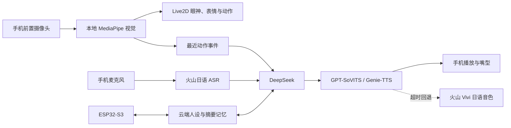

# Rem Embodied Companion · 雷姆实体陪伴终端

把旧安卓手机做成开机即进入角色界面的专用终端：前置摄像头在本地观察位置和动作，Live2D 实时看向你，DeepSeek 负责日语对话，云端保存人设与摘要记忆，GPT-SoVITS / Genie-TTS 提供参考音色合成。

本仓库整理了一套从 **立创 ESP32-S3 实战派 → Redmi Note 7 专用系统 → Live2D 视觉反馈 → 云端对话 → 参考音色部署** 的实际工程。手机与 ESP32 可以共用云端记忆身份和语音额度。日常使用只需要联网，电脑无需持续开机，也不要求处于同一局域网。

这是源码、配置模板和复现记录的公开整理版。**模型、角色美术、参考录音、完整 ROM、API 密钥、私人记忆均需自行提供；本仓库没有这些文件。** 这是个人实验项目，与角色版权方、声优或设备厂商没有合作关系。



## 已完成什么

| 能力 | 实际状态 |
| --- | --- |
| 开机进入雷姆界面 | Redmi Note 7 / lavender，定制 LineageOS 18.1，系统 HOME 组件 |
| 麦克风、扬声器、前后摄像头 | 真机验证，摄像头修复经过重启验证 |
| 眼睛跟随现实中的位置 | 真机确认方向正确；位置平滑、越界限制、目标丢失回正 |
| 点头、摇头、挥手、靠近/离开 | 本地识别；挥手修正版已确认 |
| 语音对话 | 按钮开始/结束录音，日语识别 → DeepSeek → 日语语音 |
| 对话理解刚才的动作 | 传事件文本；“刚才做了什么”已能回答挥手 |
| 角色音色与嘴型 | 手机端参考音色已试听验收；音量驱动嘴型 |
| 性格调整与跨设备记忆 | 人设接口和服务端身份别名已接通；记忆是摘要，不是完整聊天录像 |

目前不是全天后台摄像头服务：角色在前台、屏幕开启且观察开关打开时运行；退后台、熄屏和进入硬件维护时释放摄像头。语音仍由按钮触发，没有自动视觉语音插话，也没有上线自定义唤醒词、语音换装或通用场景识别。

## 从哪里看起

1. [整体架构与能力边界](docs/01-architecture.md)
2. [ESP32 与云端部署](docs/02-cloud-and-esp32.md)
3. [专用手机系统：构建、刷入与驱动修复](docs/03-phone-system.md)
4. [Live2D、摄像头跟随与动作识别](docs/04-vision-live2d.md)
5. [手机对话、人设与共享记忆](docs/05-phone-cloud.md)
6. [GPT-SoVITS 到低配云端的音色部署](docs/06-voice.md)
7. [故障记录与排查顺序](docs/07-troubleshooting.md)
8. [验证记录、版本与后续工作](docs/08-validation.md)
9. [数据流、公开范围与资产准备](docs/09-privacy-assets.md)
10. [第三方来源与许可](THIRD_PARTY_NOTICES.md)

## 代码布局

```text
rem-cloud/          小智服务适配、手机 API、额度、人设和摘要记忆
rem-phone-system/  lavender 产品配置、系统 HOME、视觉策略、渲染桥和构建修复
rem-voice/          GPT-SoVITS 试听、ONNX 转换、低内存推理及私有语音服务
docs/              全流程说明、排错与验收记录
scripts/           公开文件检查、资产补齐和离线测试入口
```

## 先跑不涉及设备或计费的测试

Linux / WSL，Python 3.10+、Node.js 18+、JDK 11+（音色转换和完整资产工具建议 Python 3.12）：

```bash
python3 -m venv .venv
. .venv/bin/activate
python -m pip install -r requirements-dev.txt
bash scripts/test-offline.sh
```

这组测试使用模拟 ASR/LLM/TTS 和临时文件，不调用付费 API、不启用摄像头、不连接手机、不加载模型。GitHub Actions 执行同一入口。完整 Android 构建还需要上游源码、厂商文件和外部模型，详见手机系统文档。

## 复现顺序

先跑离线测试；准备 DeepSeek / 火山账号与 HTTPS 云端；在正确机型完成系统基础功能；补齐自有 Live2D 和视觉依赖；登记独立手机凭据；验证基础日语语音；最后试听参考音色并接入 Genie。每阶段通过后再进入下一阶段，便于定位网络、硬件、模型和声音各自的问题。

整理时点：2026-11-15。文档中的硬件、费用与性能属于本次工程记录，不承诺在其他机型、账号或后续版本上相同。
