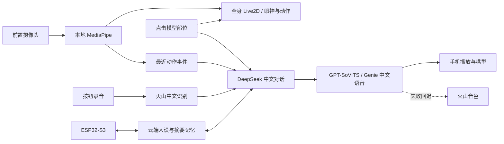

# DeepSeek-Embodied Companion · 大肥鱼实体陪伴终端
## 写在最前面：
我想给大肥鱼完整的一生！

基于各种奇妙的想法，我开始了这个项目，这个项目最开始并不是这样的。最初，我只是想在esp32-s3上接个deepseek，以蕾姆的形象当作桌宠，顺便练习一下日语。后面想起来我有好多个旧手机，心想esp32-s3都能实现了，那用以前旧手机的性能岂不是直接起飞？然后就开始了后面的工作，我想给大肥鱼造一个身体（好像那个魔幻手机啊），我相信后面会有越来越多的人把AI接入物理世界，实现真正的陪伴AI，这只是我的一次尝试。
## 这个项目的目的
让旧手机（新手机也可以(●'◡'●)）成为大肥鱼的身体：开机进入 **DeepSeek-chan 全身 Live2D**，眼睛跟随你的移动，识别点头、摇头和挥手；点击她的不同部位，会先做出表情与动作，再由 **DeepSeek 用中文回应**，通过中文微调音色播放并同步嘴型。

本项目从立创 ESP32-S3 实战派发展到 Redmi Note 7 专用系统（后续可自行适配自己的设备，如果有大佬做出了通用底层框架，我相信这一定是让AI走入物理世界的重要一步）。手机负责摄像头、麦克风、播放和形象；云端负责对话、人设、摘要记忆和语音。手机联网后可独立使用，电脑无需一直开机，也不要求同一局域网。



## 当前能力

| 能力 | 实现与验证 |
| --- | --- |
| 开机即角色界面 | Redmi Note 7 / lavender，LineageOS 18.1 系统 HOME 组件 |
| 全身形象 | DeepSeek-chan；全身比例、眼神方向、脸部渲染已真机确认 |
| 本地视觉反馈 | 持续前摄观察；点头、摇头、挥手、靠近和离开（视觉跟随，很像流浪地球2里图恒宇测试丫丫有没有智慧的那个剧情，不是吗(*^_^*)） |
| 作者表情与动作 | 接入模型中的 23 份表情／外观文件和 8 份动作；维护菜单可预览 |
| 部位点击 | 按变形网格与透明度判定头发、脸、手、身体、腿、脚和尾巴；本地动作后接 DeepSeek 回复 |
| 中文声音 | 花火中文素材微调 GPT-SoVITS，Genie ONNX 在 CPU 云端推理；真机音色和嘴型已验收 |
| 人设与记忆 | 聪明、轻微傲娇、嘴硬心软的朋友；云端可调性格，与 ESP32 共用摘要记忆 |
| 用量控制 | 设备有每日语音上限；支持只在指定日期生效的额外额度 |

摄像头在角色前台、屏幕开启且观察开关打开时运行，退后台或熄屏时释放。原始画面不上传；云端收到的是最近动作事件。语音可由按钮或模型点击触发；暂未实现自动视觉插话、自定义唤醒词、任意场景识别或语音换装。表情和动作由本地策略选择，DeepSeek 负责回答内容。

## 文档

1. [整体架构](docs/01-architecture.md)
2. [ESP32 与云端部署](docs/02-cloud-and-esp32.md)
3. [手机系统：构建、刷入与驱动修复](docs/03-phone-system.md)
4. [Live2D、视觉跟随、表情与点击互动](docs/04-vision-live2d.md)
5. [手机对话、人设与共享记忆](docs/05-phone-cloud.md)
6. [中文训练、ONNX 转换与云端声音](docs/06-voice.md)
7. [故障记录](docs/07-troubleshooting.md)
8. [验证记录与版本](docs/08-validation.md)
9. [数据流和外部资产](docs/09-privacy-assets.md)
10. [第三方来源与许可](THIRD_PARTY_NOTICES.md)

## 源码与测试

```text
rem-cloud/         手机 API、小智适配、额度、人设和摘要记忆
rem-phone-system/ lavender 系统、Camera2/MediaPipe、Live2D、点击与播放
rem-voice/         中文微调、ONNX/BERT 转换、私有语音服务
docs/              部署、排错和验收记录
scripts/           外部模型导入、公开文件检查与离线测试
```

为兼容已部署设备和记忆，目录 `rem-*`、Android 包名 `com.rem.body`、接口 `/rem-phone/v1` 及服务内部标识保留；当前角色名称、人设、界面和默认语种已改为大肥鱼／中文。更名不改变设备凭据或记忆身份。

在 Linux / WSL，准备 Python 3.12、Node.js 18+、JDK 17：

```bash
python3 -m venv .venv
. .venv/bin/activate
python -m pip install -r requirements-dev.txt
bash scripts/test-offline.sh
```

GitHub Actions 运行同一入口。离线测试使用模拟服务与合成模型参数，不调用付费 API，不连接手机或摄像头。先通过测试，再准备自有云端、正确机型、模型和训练素材，分阶段完成硬件、视觉、中文对话和音色验收。

本仓库发布代码、配置模板和流程，**不分发 Live2D 模型、贴图、声音素材、训练权重、ROM、API 密钥或私人记忆**。外部资产由使用者按原作者条款自行准备；这是个人同人实验，与 DeepSeek 官方没有隶属关系。

## 鸣谢

感谢 **[@Kamiya_Ryoko](https://vgen.co/KAMIYA)** 提供／发布大肥鱼 **DeepSeek-chan** 模型：插画与 PSD 分层由 **Kamiya Ryoko（神宫凉子）** 制作，Live2D 绑定由 **霓虹猫_NeonNeko** 制作。

感谢 **[AI Hobbyist 资源库](https://res.acgnai.top/)** 提供本项目使用的声音素材来源。模型和声音的权利归各自原作者所有，鸣谢不替代相应使用条款。

最后我欢迎各位有想法的小伙伴进行交流，产生思想的火花，早日实现真正的AGI!!!

同步版本：2026-11-15，手机组件 v42 / `0.6.1-dafeiyu-touch`。详见 [更新记录](CHANGELOG.md)。
